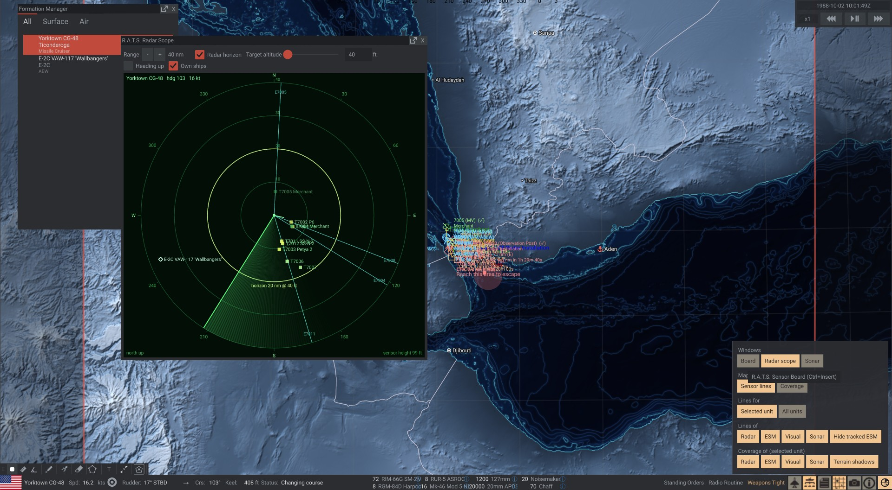

# Sea Power: R.A.T.S. Sensor Views

Shows which of your units sees which contact with which sensor, for [Sea Power: Naval Combat in the Missile Age](https://store.steampowered.com/app/1286220/), in a sensor board, a radar scope and a sonar display.

| | |
| --- | --- |
| Questions | [R.A.T.S. Discord](https://discord.gg/CzuHd4f8Yf): help, ideas, talk; the first place to ask |
| Version | `0.6.0` (unreleased) |
| Game | Sea Power 0.9.3 (build 261116), the current main version; run in the test VM |
| Needs | [R.A.T.S. Keel](https://steamcommunity.com/sharedfiles/filedetails/?id=3835527459), the mod loader, and [R.A.T.S. Rigging](https://steamcommunity.com/sharedfiles/filedetails/?id=3843688859), the part the R.A.T.S. mods share (a copy comes with this mod for now) |
| Get it | [Steam Workshop](https://steamcommunity.com/sharedfiles/filedetails/?id=3833019654) (about 280 KB) |
| Settings | Options > Sensor Views, or `BepInEx\config\dev.sewerlabs.seapowersensorviews.cfg` |
| Bug reports | [R.A.T.S. feedback board](https://hub.sewerlabs.dev/s/sensorviews) |
| Source | R.A.T.S. Source License, see `LICENSE` |



Display only: the windows show what your units' sensors already report to the game's plotting table (bearing, range and age estimates), never a contact's real position. The mission's own rules decide what a sensor can detect.

## Features

- Sensor board: your units across, the contacts down, each cell lists the sensors that hold the contact and the fix age.
- Click a cell for bearing, range and fix age per sensor; double-click a contact or unit to move the camera there.
- Radar scope for the selected unit: sweep-painted blips, covered arc, radar horizon ring, RWR and jammer strobes, lock mark.
- Sonar display: bearing over time with the baffle sector, a depth strip with the thermal layer, an echo plot, own torpedoes.
- Map layer *Sensor lines (who sees what)*: a line from each unit to where each sensor puts a contact.
- Map layer *Sensor coverage (selected unit)*: where the unit's sensors would hold an imagined target, off by default.
- All three windows are normal game windows; with *R.A.T.S. Pop-Out Windows* they get a pop-out button for a second monitor.

Full detail: [docs/features.md](docs/features.md).

## Install

1. Install [R.A.T.S. Keel](https://steamcommunity.com/sharedfiles/filedetails/?id=3835527459), the mod loader.
2. Subscribe to [Sea Power: R.A.T.S. Sensor Views](https://steamcommunity.com/sharedfiles/filedetails/?id=3833019654) on the Workshop; Steam offers its required item [R.A.T.S. Rigging](https://steamcommunity.com/sharedfiles/filedetails/?id=3843688859) with it.
3. If you already have the mod, do nothing: a copy of Rigging comes with it for now, and a notice on the main menu offers the Rigging item.
4. Start a mission and click the radar scope icon at the right end of the bottom bar.

Manual install: put the mod folder `SeaPowerSensorViews` into the game's `StreamingAssets` folder.

## Hot keys

| Window or layer | Default key |
| --- | --- |
| Sensor board | `Ctrl+Insert` |
| Radar scope | `Ctrl+PageUp` |
| Sonar display | `Ctrl+PageDown` |
| Sensor lines layer | `Ctrl+Shift+PageUp` |
| Coverage layer | `Ctrl+Shift+PageDown` |

## Settings

| Setting | Default | What |
| --- | --- | --- |
| Sensor lines | on | lines of the selected unit only (*Units shown*), or all units |
| Sensor coverage | off | rings for the selected unit |
| Lost contacts stay | 60 s | dimmed on the board and scope |
| Eye or infrared contact lost after | 30 s | after its last sighting |
| Target altitude, radar cross section | 100 ft, 10 m2 | for the scope's horizon ring and the coverage |

- All settings: `BepInEx\config\dev.sewerlabs.seapowersensorviews.cfg`; most are on the Options screen's *Sensor Views* tab. Hot keys and the rest: [docs/features.md](docs/features.md).

## Building

- Needs the .NET SDK, a Sea Power install and the SeaPowerRigging repo (R.A.T.S. Rigging) next to this one.
- One build for the game's current main version.

```
dotnet build src/SeaPowerSensorViews -c Release -p:Deploy=false -p:ManagedDir=<Sea Power_Data\Managed>
```

Details and the repo layout: [docs/building.md](docs/building.md). Windows: [docs/windows.md](docs/windows.md); map layers: [docs/map-layers.md](docs/map-layers.md); tests: [docs/testing.md](docs/testing.md); notes: [HANDOVER.md](HANDOVER.md).

## Credits and license

- [R.A.T.S. Source License](LICENSE): read it, fork it, send fixes; no re-uploads, no reuse in other projects.
- Works with [R.A.T.S. Pop-Out Windows](https://github.com/struckl/SeaPowerPopOut). No game files are changed.
- Not affiliated with Triassic Games or MicroProse.

*R.A.T.S. - Ratte's Assorted Tactical Systems*
